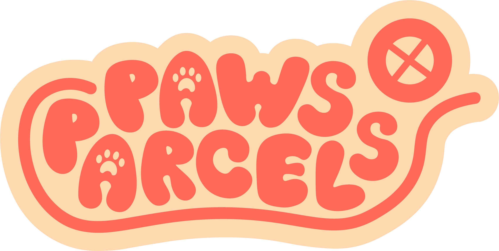
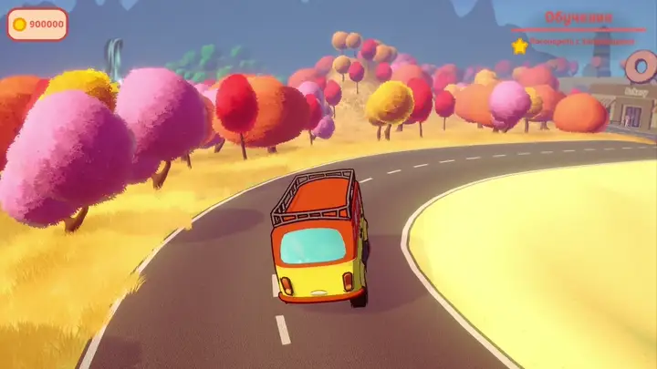
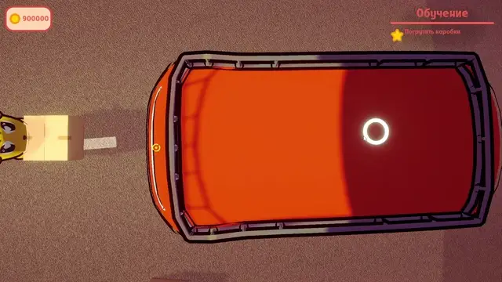

<p align="center">
  
</p>

<h1 align="center">A little van. A lot to deliver.</h1>

<p align="center">A 3D delivery adventure about driving, loading cargo and helping the locals.</p>

<p align="center">
  
  
  
  
  
</p>

<p align="center">
  <b>English</b> · <a href="README.ru.md">Русский</a><br>
  <a href="#the-game">The game</a> · <a href="#my-contribution">My contribution</a> · <a href="#inside-the-code">Inside the code</a> · <a href="#run-the-project">Run the project</a>
</p>

<p align="center">
  
</p>

## The game

**Paws&Parcels** is a Unity game made by **Coffeebreak** for the **National Technology Olympiad (NTO), Game Development track**. Take delivery jobs, load parcels into your van, explore a colourful town and meet its animal residents.

The MVP was completed in approximately **two months**, followed by **one week of work during the finals**. The team received a **special nomination from Ninsar.Games** and an invitation to an internship.

### Pick up. Pack. Drive. Deliver.

| System | What happens in the game |
| --- | --- |
| **Cargo** | Pick up and throw items, place parcels inside the van or on its roof, and deliver them to their destinations. |
| **Driving** | Drive with physics-based suspension, steering and handbrake behaviour; manage fuel and recover the van when needed. |
| **Quests & dialogue** | Talk to residents, progress through multi-stage missions, follow objectives and earn rewards. Some missions have time limits. |
| **Navigation** | Use the map, destination markers and quest diary to find your next stop. |
| **Progress** | Save and load game state, with save-slot metadata and screenshot previews. |

<p align="center">
  <br>
  <sub>Cargo loading — footage from the project's in-game tutorial.</sub>
</p>

## My contribution

I'm **[Vyacheslav Samuilenko](https://github.com/Ivanaki)**, the project's programmer. My work covered the gameplay systems and the technical structure of the Unity project:

- Built the **quest, cargo and save systems**.
- Organised the application into **services**, connected through **Zenject** dependency injection.
- Used **MVVM** for the interface, with reactive state through **R3** and **ObservableCollections**.
- Adapted the **vehicle physics** for the delivery gameplay and transporting cargo.
- Integrated gameplay, UI and scene transitions into the MVP.

## Inside the code

The project separates game state, gameplay services and UI presentation. ScriptableObjects hold game configuration; reactive properties and messages connect state changes to quests and interface updates.

| Area | Implementation | Start reading |
| --- | --- | --- |
| **Composition & scene flow** | Zenject bindings, application entry point and scene transition parameters | [GlobalProjectInstaller](Paws-Parcels/Assets/Paws-Parcels/Scripts/Zenject/GlobalProjectInstaller.cs) · [GameEntryPoint](Paws-Parcels/Assets/Paws-Parcels/Scripts/EntryPoints/GameEntryPoint.cs) |
| **Quests** | Message-driven mission progress, dialogue objectives, destinations, timers and rewards | [QuestsService](Paws-Parcels/Assets/Paws-Parcels/Scripts/Quests/QuestsService.cs) |
| **Cargo** | Item state, pickup/drop logic, throwing trajectories and loading interactions | [ItemsSystem](Paws-Parcels/Assets/Paws-Parcels/Scripts/Items/ItemsSystem.cs) · [PutInCarItemsService](Paws-Parcels/Assets/Paws-Parcels/Scripts/Car%26Player/PutInCarItemsService.cs) |
| **Vehicle** | Raycast suspension, wheel forces, steering and handbrake logic | [Car](Paws-Parcels/Assets/Paws-Parcels/Scripts/CarMovement/Logic/Car.cs) · [RaycastSpring](Paws-Parcels/Assets/Paws-Parcels/Scripts/CarMovement/Logic/RaycastSpring.cs) |
| **Persistence** | JSON game state, save metadata and screenshot previews | [GameStateProvider](Paws-Parcels/Assets/Paws-Parcels/Scripts/Saves/States/GameState/GameStateProvider.cs) |
| **UI** | ViewModels expose reactive state; binders connect it to Unity UI | [OneQuestViewModel](Paws-Parcels/Assets/Paws-Parcels/Scripts/UI/Screens/Quests/OneQuestViewModel.cs) · [OneQuestBinder](Paws-Parcels/Assets/Paws-Parcels/Scripts/UI/Screens/Quests/OneQuestBinder.cs) |

### Stack

| Category | Tools |
| --- | --- |
| Language | C# |
| Engine & rendering | Unity 6 · Universal Render Pipeline |
| Architecture | Service separation · Zenject · MVVM |
| Reactive state | R3 · ObservableCollections |
| Dialogue & localisation | Yarn Spinner · Unity Localization |
| Input & cameras | Unity Input System · Cinemachine |
| Persistence | JSON · Newtonsoft.Json |

## Run the project

This repository contains the **Unity source project**. A downloadable game build is not currently published in GitHub Releases.

1. Install **Unity Hub**, **Git** and **Unity 6000.3.18f1** — the version recorded in [ProjectVersion.txt](Paws-Parcels/ProjectSettings/ProjectVersion.txt).
2. Clone the repository:

   ```bash
   git clone https://github.com/Ivanaki/Paws-Parcels.git
   ```

3. In Unity Hub, select **Add project from disk** and choose the **inner `Paws-Parcels` folder**, which contains `Assets`, `Packages` and `ProjectSettings`.
4. Open the project and let Unity finish importing assets and resolving packages. An internet connection is needed for Git-based dependencies. If NuGetForUnity reports missing packages, use its **Restore** command.
5. Open **`Assets/Paws-Parcels/Scenes/Boot.unity`** and press **Play**. Boot leads to the main menu; start a new game from there.

The configured scenes are Boot, `Assets/MotorHome/Scenes/Core.unity` and `Assets/MotorHome/Scenes/MainMenu.unity`. See [EditorBuildSettings.asset](Paws-Parcels/ProjectSettings/EditorBuildSettings.asset) for their order.

### Keyboard controls

| Action | Key |
| --- | --- |
| Move / drive | **W A S D** |
| Sprint on foot | **Left Shift** |
| Jump | **Space** |
| Interact / exit the van | **E** |
| Drop an item | **Q** or **G** |
| Handbrake | **Space** or **Left Shift** |
| Quest diary | **Tab** |
| Map | **M** |
| Pause | **Esc** |

Bindings are defined in [InputSystem_Actions.inputactions](Paws-Parcels/Assets/InputSystem_Actions.inputactions). The in-game tutorial explains cargo interactions.

## Team & credits

Created by **Coffeebreak**. Programming and technical implementation: **[Vyacheslav Samuilenko / Ivanaki](https://github.com/Ivanaki)**. Art, models and other production work were a team effort; see the [repository contributors](https://github.com/Ivanaki/Paws-Parcels/graphs/contributors).

The logo and gameplay footage shown here come from the project. Third-party packages and assets retain their respective licences and attribution.
