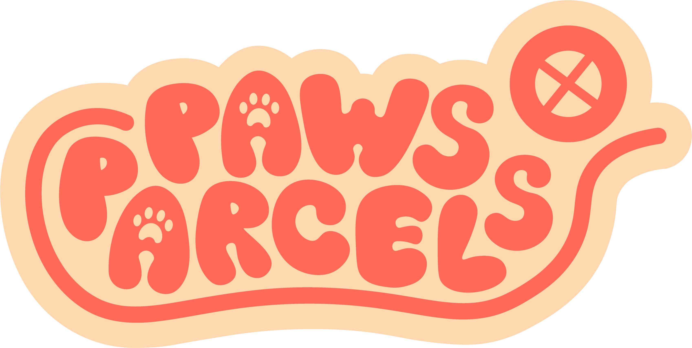
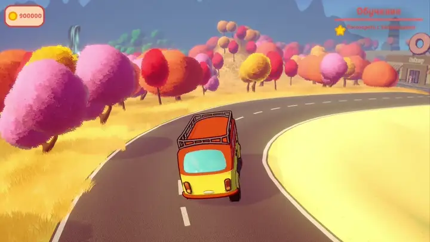
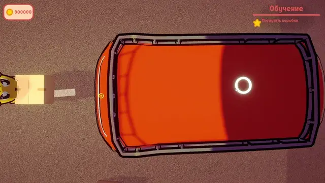

<p align="center">
  
</p>

<h1 align="center">Маленький фургон. Большие доставки.</h1>

<p align="center">Трёхмерное приключение с доставкой посылок, физикой грузов и историями местных жителей.</p>

<p align="center">
  
  
  
  
  
</p>

<p align="center">
  <a href="README.md">English</a> · <b>Русский</b><br>
  <a href="#об-игре">Об игре</a> · <a href="#мой-вклад">Мой вклад</a> · <a href="#как-устроен-код">Как устроен код</a> · <a href="#запуск-проекта">Запуск проекта</a>
</p>

<p align="center">
  
</p>

## Об игре

**Paws&Parcels** — игра на Unity, созданная командой **Coffeebreak** для **НТО по профилю «Разработка компьютерных игр»**. Игрок берёт заказы, загружает посылки в фургон, исследует яркий городок и знакомится с его жителями-животными.

Разработка MVP заняла примерно **два месяца**, затем — ещё **неделю доработки на финале**. Команда получила **специальную номинацию Ninsar.Games** и приглашение на стажировку.

### Забрать. Погрузить. Довезти. Доставить.

| Система | Что можно делать в игре |
| --- | --- |
| **Грузы** | Поднимать и бросать предметы, размещать посылки внутри фургона и на крыше, доставлять их по назначению. |
| **Вождение** | Управлять машиной с физикой подвески, рулевого управления и ручного тормоза; следить за топливом и возвращать машину после застревания. |
| **Квесты и диалоги** | Общаться с жителями, проходить задания из нескольких этапов, следовать целям и получать награды. У части заданий есть ограничение по времени. |
| **Навигация** | Искать следующую точку доставки с помощью карты, маркеров и дневника заданий. |
| **Прогресс** | Сохранять и загружать состояние игры; выбирать сохранения с метаданными и скриншотами. |

<p align="center">
  <br>
  <sub>Погрузка посылки — фрагмент встроенного в игру обучающего видео.</sub>
</p>

## Мой вклад

Я — **[Вячеслав Самуйленко](https://github.com/Ivanaki)**, программист проекта. Отвечал за игровые системы и техническую структуру проекта в Unity:

- Разработал **системы квестов, работы с грузами и сохранений**.
- Организовал приложение через **сервисы** и внедрение зависимостей с **Zenject**.
- Использовал **MVVM** для интерфейса, **R3** и **ObservableCollections** для реактивного состояния.
- Адаптировал **физику машины** под доставку и перевозку грузов.
- Объединил игровые механики, интерфейс и переходы между сценами в MVP.

## Как устроен код

Состояние игры, игровые сервисы и отображение интерфейса разделены. Настройки хранятся в ScriptableObjects; реактивные свойства и сообщения связывают изменения состояния с заданиями и интерфейсом.

| Область | Реализация | С чего начать просмотр |
| --- | --- | --- |
| **Сборка приложения и сцены** | Регистрация зависимостей Zenject, точка входа и параметры переходов между сценами | [GlobalProjectInstaller](Paws-Parcels/Assets/Paws-Parcels/Scripts/Zenject/GlobalProjectInstaller.cs) · [GameEntryPoint](Paws-Parcels/Assets/Paws-Parcels/Scripts/EntryPoints/GameEntryPoint.cs) |
| **Квесты** | Прогресс через сообщения, диалоги, точки назначения, таймеры и награды | [QuestsService](Paws-Parcels/Assets/Paws-Parcels/Scripts/Quests/QuestsService.cs) |
| **Грузы** | Состояние предметов, поднятие и бросок, траектория полёта и погрузка | [ItemsSystem](Paws-Parcels/Assets/Paws-Parcels/Scripts/Items/ItemsSystem.cs) · [PutInCarItemsService](Paws-Parcels/Assets/Paws-Parcels/Scripts/Car%26Player/PutInCarItemsService.cs) |
| **Машина** | Подвеска через raycast, силы колёс, рулевое управление и ручной тормоз | [Car](Paws-Parcels/Assets/Paws-Parcels/Scripts/CarMovement/Logic/Car.cs) · [RaycastSpring](Paws-Parcels/Assets/Paws-Parcels/Scripts/CarMovement/Logic/RaycastSpring.cs) |
| **Сохранения** | JSON-состояние игры, метаданные и скриншоты | [GameStateProvider](Paws-Parcels/Assets/Paws-Parcels/Scripts/Saves/States/GameState/GameStateProvider.cs) |
| **Интерфейс** | ViewModel предоставляет реактивное состояние, Binder связывает его с Unity UI | [OneQuestViewModel](Paws-Parcels/Assets/Paws-Parcels/Scripts/UI/Screens/Quests/OneQuestViewModel.cs) · [OneQuestBinder](Paws-Parcels/Assets/Paws-Parcels/Scripts/UI/Screens/Quests/OneQuestBinder.cs) |

### Технологии

| Категория | Инструменты |
| --- | --- |
| Язык программирования | C# |
| Движок и рендеринг | Unity 6 · Universal Render Pipeline |
| Архитектура | Разделение на сервисы · Zenject · MVVM |
| Реактивное состояние | R3 · ObservableCollections |
| Диалоги и локализация | Yarn Spinner · Unity Localization |
| Ввод и камеры | Unity Input System · Cinemachine |
| Хранение данных | JSON · Newtonsoft.Json |

## Запуск проекта

В репозитории находится **исходный Unity-проект**. Готовая сборка игры пока не опубликована в GitHub Releases.

1. Установить **Unity Hub**, **Git** и **Unity 6000.3.18f1** — версия указана в [ProjectVersion.txt](Paws-Parcels/ProjectSettings/ProjectVersion.txt).
2. Клонировать репозиторий:

   ```bash
   git clone https://github.com/Ivanaki/Paws-Parcels.git
   ```

3. В Unity Hub выбрать **Add project from disk** и указать **внутреннюю папку `Paws-Parcels`**, где лежат `Assets`, `Packages` и `ProjectSettings`.
4. Открыть проект, дождаться импорта ресурсов и загрузки пакетов. Для зависимостей из Git нужен интернет. Если NuGetForUnity сообщит о недостающих пакетах, выполнить его команду **Restore**.
5. Открыть **`Assets/Paws-Parcels/Scenes/Boot.unity`** и нажать **Play**. Из загрузочной сцены игра перейдёт в главное меню, откуда можно начать новую игру.

В настройках указаны сцены Boot, `Assets/MotorHome/Scenes/Core.unity` и `Assets/MotorHome/Scenes/MainMenu.unity`. Их порядок можно проверить в [EditorBuildSettings.asset](Paws-Parcels/ProjectSettings/EditorBuildSettings.asset).

### Управление с клавиатуры

| Действие | Клавиша |
| --- | --- |
| Движение / управление машиной | **W A S D** |
| Бег пешком | **Left Shift** |
| Прыжок | **Пробел** |
| Взаимодействие / выход из машины | **E** |
| Бросить предмет | **Q** или **G** |
| Ручной тормоз | **Пробел** или **Left Shift** |
| Дневник заданий | **Tab** |
| Карта | **M** |
| Пауза | **Esc** |

Привязки заданы в [InputSystem_Actions.inputactions](Paws-Parcels/Assets/InputSystem_Actions.inputactions). Встроенное обучение объясняет взаимодействие с грузами.

## Команда и авторство

Проект создан командой **Coffeebreak**. Программирование и техническая реализация — **[Вячеслав Самуйленко / Ivanaki](https://github.com/Ivanaki)**. Графика, модели и остальные составляющие игры — результат командной работы; [участники репозитория](https://github.com/Ivanaki/Paws-Parcels/graphs/contributors).

Логотип и записи игрового процесса взяты из самого проекта. Сторонние пакеты и ресурсы сохраняют собственные лицензии и указания авторства.
